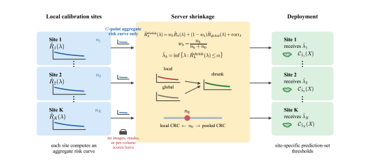
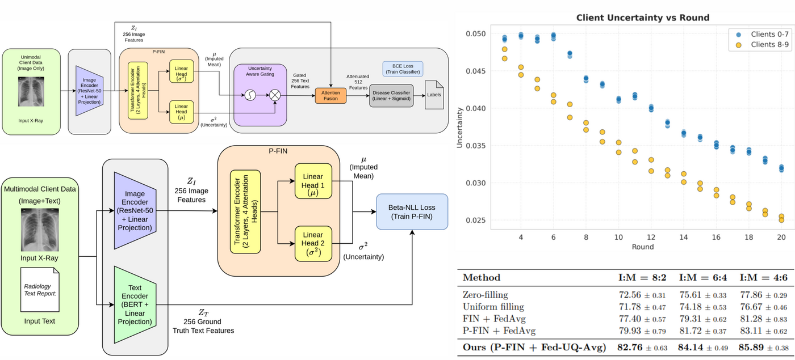
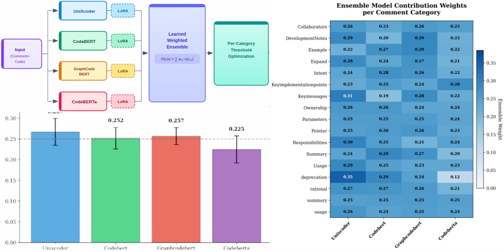

I am a final-year **B.Sc. in Computer Science and Engineering** student at the
[Islamic University of Technology (IUT)](https://www.iutoic-dhaka.edu/) and an
**Associate Software Engineer** on the FinTech team at
[Brain Station 23](https://brainstation-23.com/). My research builds
**trustworthy and reliable machine-learning systems**, with an emphasis on
**medical AI**. I am especially interested in how models can quantify and
communicate what they do not know, so that AI stays dependable in high-stakes
settings such as healthcare.

My research interests are **trustworthy medical AI**; **uncertainty
quantification and calibration**; **multimodal learning for medical data**; and
**reliable large language model (LLM) systems**.

  <a href="mailto:nafisfuadshahid@gmail.com">Email</a> &middot;
  <a href="https://scholar.google.com/citations?user=cRwM_j8AAAAJ&hl=en">Google Scholar</a> &middot;
  <a href="https://github.com/NafisFuadShahid">GitHub</a> &middot;
  <a href="https://www.linkedin.com/in/nafisfuadshahid/">LinkedIn</a> &middot;
  <a href="/files/Nafis_Fuad_Shahid_CV.pdf">CV (PDF)</a>

News
======
- **Aug 2026.** [*When Calibration Fails the Vulnerable Hospital*](/publication/2026-federated-conformal) was accepted for **oral presentation** at the [DeCaF Workshop](https://workshop-decaf.github.io/decaf-2026/), MICCAI 2026 (Strasbourg).
- **Jul 2026.** [*Probabilistic Feature Imputation and Uncertainty-Aware Multimodal Federated Aggregation*](/publication/2026-pfin-fed-uq) was published in **PMLR** at [MIDL 2026](https://2026.midl.io/) (Taipei).
- **Apr 2026.** [*LoRA-MME*](/publication/2026-lora-mme) was published by **ACM** at [NLBSE'26](https://nlbse2026.github.io/index.html) @ ICSE 2026, where it took **2nd place** with the highest F1 of any submission.
- **Feb 2026.** [*The Stealth of Free Rider Attacks*](/publication/2026-free-rider-attacks) was accepted at [CCCN 2026](https://www.cccn.net/).
- **Sep 2025.** Joined **Brain Station 23** as an Associate Software Engineer on the FinTech team.
- **2025.** Won **Champion of Champions** at Geeky Solutions Learnathon 3.0, and reached the **Top 10** at the Vivasoft AI Hackathon 2025.

Research Highlights
======

**[Federated Conformal Risk Control via Risk-Curve Shrinkage](/publication/2026-federated-conformal)** &middot; *[DeCaF](https://workshop-decaf.github.io/decaf-2026/) @ MICCAI 2026 (Oral Presentation), sole author*
 

 Pooled federated calibration can look reliable on average while breaking its coverage guarantee at 40% of individual hospitals. Risk-curve shrinkage restores per-site reliability with a 97.6% reduction in prediction-set inflation.

**[Uncertainty-Aware Multimodal Federated Aggregation](/publication/2026-pfin-fed-uq)** &middot; *[MIDL 2026](https://2026.midl.io/) (PMLR), first author*
 

 When most hospitals hold images but not text reports, P-FIN imputes the missing modality with calibrated uncertainty, then uses it to gate unreliable features and down-weight unreliable clients. AUC improves by +5.36% in the hardest setting.

**[LoRA-MME: Multi-Model Ensemble for Code Comment Classification](/publication/2026-lora-mme)** &middot; *[NLBSE'26](https://nlbse2026.github.io/index.html) @ ICSE 2026, 2nd place*
 

 Four code transformers, each LoRA-tuned so the whole ensemble fits one GPU, combined with learned per-category weights and per-(language, category) thresholds. Highest F1 of any submission (Weighted F1 0.7906, Macro F1 0.6867).

Awards &amp; Honors
======
- **Champion of Champions**, Geeky Solutions Learnathon 3.0 (2025). Java Stack Champion and overall winner among 7 category champions, from 3,000+ applicants across 60+ universities.
- **Top 10 Finalist**, Vivasoft AI Hackathon 2025. Youngest team to reach the finals among 500+ participants.
- **Codeforces** competitive programming, peak rating 1244 (2023). [Profile](https://codeforces.com/profile/NafiShahid).

See my full list of [awards](/awards/), [publications](/publications/), and [experience](/experience/).
