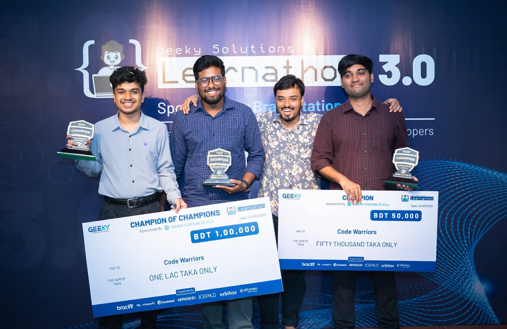
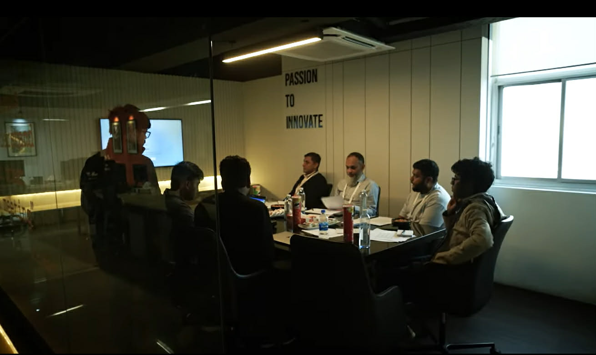

  <h3 style="margin-top:0;">Champion of Champions, Geeky Solutions Learnathon 3.0 &middot; 2025</h3>
  
Java Stack Champion, then overall winner among the seven category champions from a field of over 3,000 applicants across 60+ universities.

  <figure style="margin:0;">
    
    <figcaption style="font-size:0.85em;color:#777;margin-top:0.4em;">Learnathon 3.0: Champion of Champions</figcaption>
  </figure>

  <h3 style="margin-top:0;">Top 10 Finalist, Vivasoft AI Hackathon 2025 &middot; 2025</h3>
  
Youngest team to reach the finals among more than 500 participants.

  <figure style="margin:0;">
    
    <figcaption style="font-size:0.85em;color:#777;margin-top:0.4em;">Vivasoft AI Hackathon 2025: Top 10 Finalist</figcaption>
  </figure>

  <h3 style="margin-top:0;">Competitive Programming, Codeforces &middot; 2023</h3>
  
Peak rating 1244. Profile: <a href="https://codeforces.com/profile/NafiShahid">codeforces.com/profile/NafiShahid</a>.

