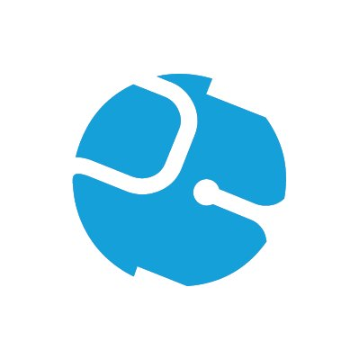
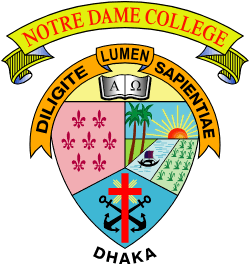

Industry Experience
------

  

    
    <strong>Associate Software Engineer</strong>, Brain Station 23 (FinTech Team) Sep 2025 to Present &middot; Dhaka
  

  <ul style="margin:0;">
    <li>Built <strong>Brain Assistant</strong>, an AI customer-support layer using hybrid RAG (vector, keyword, and knowledge-graph retrieval) with confidence-aware human fallback.</li>
    <li>Independently built <strong>Docket</strong>, a multi-tenant AI compliance platform for regulatory reporting (Spring Boot, FastAPI, hybrid RAG/GraphRAG).</li>
    <li>Built and maintained core-banking backend microservices (Spring Boot, PostgreSQL).</li>
  </ul>

  

    
    <strong>Junior Software Engineer</strong>, Inovace Technologies Jun 2025 to Aug 2025 &middot; Dhaka
  

  <ul style="margin:0;">
    <li>Built biometric deduplication to prevent duplicate employee sign-ins.</li>
    <li>Built a real-time Guard Monitoring System for patrol attendance and route tracking.</li>
  </ul>

Education
------

  

    
    <strong>B.Sc. in Computer Science and Engineering</strong> Islamic University of Technology (IUT), Gazipur
  

  

    
    <strong>Higher Secondary Certificate (HSC)</strong> Notre Dame College, Dhaka
  

