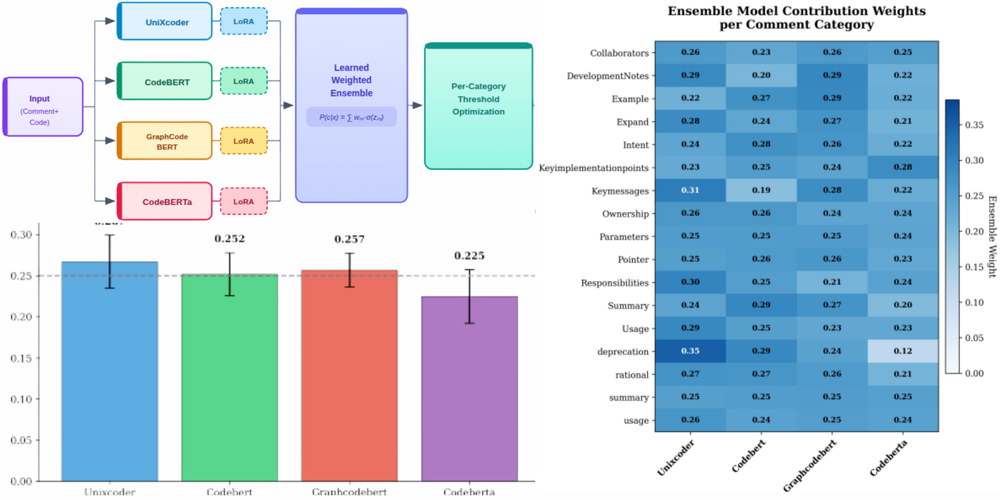

**2nd place at the [NLBSE&rsquo;26](https://nlbse2026.github.io/index.html) Tool Competition. Equal-contribution author.**

<figure style="margin:1.5em 0;">
  
  <figcaption style="font-size:0.85em;color:#777;margin-top:0.4em;">LoRA-MME architecture and learned ensemble weights per comment category.</figcaption>
</figure>

Code comment classification categorizes documentation sentences (summary, usage, parameters, deprecation, and related types) across Java, Python, and Pharo. Lightweight sentence-embedding methods are efficient but underuse code-specific pretrained knowledge, while fully fine-tuning several large code models as an ensemble is memory-prohibitive. LoRA-MME addresses this trade-off.

The objective is to obtain the accuracy of an ensemble without its usual memory cost. Four complementary code encoders, UniXcoder, CodeBERT, GraphCodeBERT, and CodeBERTa, are each adapted with Low-Rank Adaptation (LoRA), training only about 4.5% of parameters per model (approximately 5.9M) so that the full ensemble fits on a single consumer GPU. Two design choices account for the performance:

- **Learned per-category weights.** Rather than averaging the four models uniformly, the ensemble learns a weight vector for each comment category, allowing it to rely on whichever encoder is strongest for that label (for example, GraphCodeBERT for structure-related categories).
- **Per-(language, category) threshold optimization.** Rather than a fixed 0.5 cutoff, decision thresholds are tuned per language and category on validation data. This single step added +0.0355 Macro F1 over a fixed-threshold baseline.

On the held-out test set the tool reached **Weighted F1 0.7906** and **Macro F1 0.6867**, the highest F1 among all competition submissions, with the largest gains on the harder Python and Pharo taxonomies.

[ACM DOI](https://doi.org/10.1145/3786164.3794837) &middot; [arXiv:2603.03959](https://arxiv.org/abs/2603.03959) &middot; [PDF](/files/nlbse.pdf)
