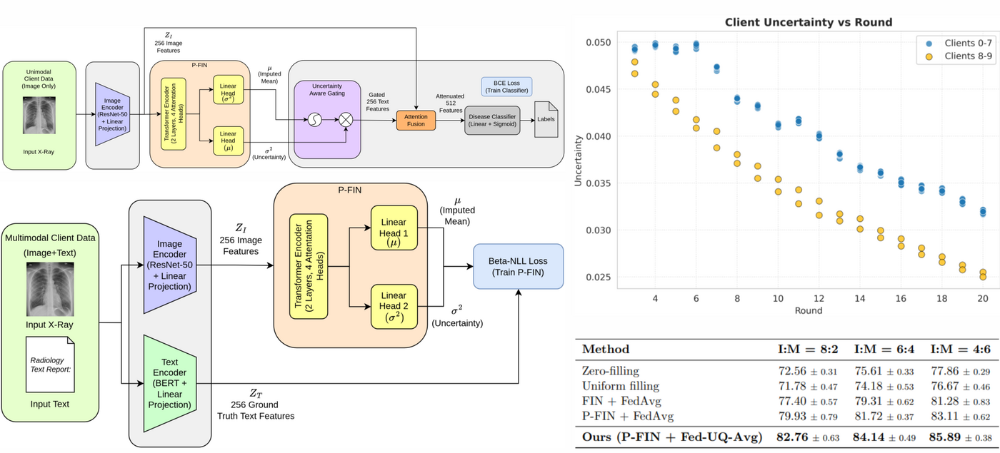

**First author.** Published in PMLR ([MIDL 2026](https://2026.midl.io/)).

<figure style="margin:1.5em 0;">
  
  <figcaption style="font-size:0.85em;color:#777;margin-top:0.4em;">P-FIN imputes missing text features with calibrated uncertainty; Fed-UQ-Avg down-weights unreliable clients during aggregation.</figcaption>
</figure>

Federated learning lets hospitals train a shared diagnostic model without exchanging patient data. In practice, however, large centers hold both chest X-rays and radiology reports, while smaller or rural clinics often hold only the images. Prior work fills in the missing text modality with a deterministic imputation network, which produces a single confident estimate even when the image is ambiguous. In a safety-critical setting, treating such a synthesized feature as fully trustworthy is a dangerous failure mode.

This work makes the imputation express its own reliability, and then exploits that uncertainty in two places:

- **Calibrated imputation (P-FIN).** Rather than a point estimate, the Probabilistic Feature Imputation Network outputs a Gaussian (mean and per-dimension variance), trained with a &beta;-NLL loss that prevents the model from trivially minimizing the objective by inflating its predicted variance. Predicted uncertainty tracks the actual imputation error (ECE 0.0422).
- **Local uncertainty gating.** Before fusion, a sigmoid gate driven by the predicted variance suppresses the feature dimensions the network is least certain about, so that unreliable imputations do not propagate into the classifier.
- **Global uncertainty-aware aggregation (Fed-UQ-Avg).** Standard FedAvg weights each hospital only by dataset size. Fed-UQ-Avg combines that with an imputation-confidence weight, so that a client with many samples but poor imputations no longer dominates the global model.

On federated chest X-ray classification (CheXpert, NIH Open-I, PadChest), the method consistently outperforms deterministic baselines across all client mixes, with a **+5.36% absolute AUC** gain in the most challenging 8:2 setting, where 80% of clients lack text.

[PMLR](https://proceedings.mlr.press/v315/shahid26a.html) &middot; [arXiv:2604.12970](https://arxiv.org/abs/2604.12970) &middot; [Code](https://github.com/NafisFuadShahid/PFIN-UQAVG) &middot; [PDF](/files/midl26.pdf)
