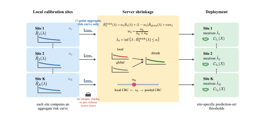

**Accepted for oral presentation at the [DeCaF Workshop](https://workshop-decaf.github.io/decaf-2026/), MICCAI 2026. Sole author.**

<figure style="margin:1.5em 0;">
  
  <figcaption style="font-size:0.85em;color:#777;margin-top:0.4em;">Each site computes a local risk curve; the server shrinks them toward a shared reference, yielding site-specific prediction-set thresholds.</figcaption>
</figure>

Conformal risk control provides a model with a formal guarantee: its prediction sets contain the true label at least a chosen fraction of the time. In a federated setting, a natural shortcut is to calibrate once on the pooled statistics across all hospitals. This work shows why that shortcut is dangerous for precisely the sites least able to absorb it.

On FeTS-2022 (1,251 brain tumor volumes across 20 institutions), naive pooled federated conformal risk control appears well calibrated on average, yet it silently **violates its coverage guarantee at 40% of individual sites**, typically the smaller institutions whose distribution differs from the pooled majority. The pooled average conceals these site-level violations.

The proposed method, **risk-curve shrinkage**, treats each site's risk curve as a noisy estimate and shrinks it toward a shared reference, trading a small amount of pooled tightness for reliable per-site coverage. It requires minimal additional communication and reduces prediction-set inflation by **97.6%** relative to calibrating every site independently, so that smaller hospitals retain their coverage guarantee without the inflation incurred by fully independent calibration.

[arXiv:2606.20115](https://arxiv.org/abs/2606.20115)
